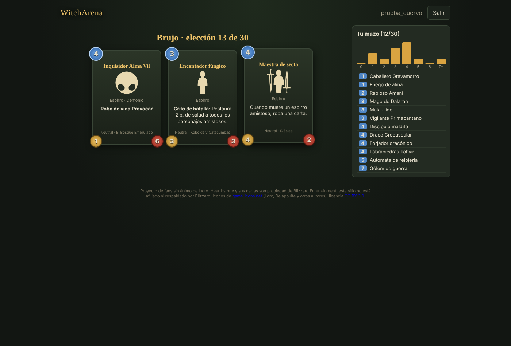
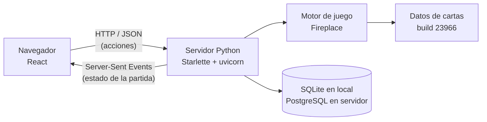

<div align="center">

# 🕯️ WitchArena

### El Arena de Hearthstone tal y como era en abril de 2018

*Vuelve a jugar el Arena del Año del Cuervo, recién estrenado El Bosque Embrujado, contra otras personas y online.*


</div>

---

## ✨ Qué es

WitchArena es una web hecha por fans para jugar el **modo Arena de Hearthstone en PvP**, con las
**reglas, cartas y balance exactos del parche 11.0** (10 de abril de 2018):

- 🧙 **Draft completo**: eliges entre 3 clases y haces 30 elecciones de 1 entre 3 cartas.
- ⚔️ **Partidas contra otras personas** en tiempo real, con mulligan, Descubrir, Elige una opción, secretos y armas.
- 🏆 **Runs de Arena reales**: hasta **12 victorias o 3 derrotas**, con historial.
- 📜 **Cartas en español** con sus textos de 2018, sin arte de Blizzard: cada carta lleva un icono libre relacionado con ella.
- 🖐️ **Cartas que se arrastran**: coloca cada esbirro en el hueco que quieras de tu fila; los hechizos con objetivo se convierten en una flecha al salir de la mano.
- 🎯 **Flechas de ataque** que siguen al ratón y animación de ataque visible para los dos jugadores.
- 🔍 **Vista previa al pasar el ratón** (en la mesa y en el registro): la carta original con sus valores base y las mejoras que tiene encima, y de dónde vienen.
- 🛡️ **Provocar** se ve como un escudo detrás del esbirro; **Escudo divino**, como un halo dorado.

| Draft | Atacando |
|:---:|:---:|
|  |  |

---

## 🚀 Ponerlo en marcha (Windows)

> Necesitas **Python 3.10+**. Node.js solo hace falta si quieres recompilar la web (ya viene compilada en `frontend/dist`).

1. Descarga o clona el repositorio.
2. Doble clic en **`instalar.bat`**. Crea el entorno de Python, instala dependencias, prepara la base de
   datos y crea usuarios de prueba (contraseñas en `backend/test_users.txt`, que nunca se sube a git).
3. Doble clic en **`iniciar.bat`**. Arranca el servidor y abre **http://127.0.0.1:8000**.

Para probar una partida solo, abre una ventana normal y otra de incógnito y entra con dos usuarios distintos.

### 🌍 Publicarlo en internet desde tu PC (Cloudflare Tunnel)

Sin abrir puertos del router ni exponer tu IP:

1. **`descargar_cloudflared.bat`**: baja `cloudflared.exe` (versión portable oficial) a la carpeta `tunel/`.
2. **`publicar.bat`**: arranca el servidor en **modo público** y abre un túnel. Al terminar te muestra la dirección
   `https://….trycloudflare.com` (también queda guardada en `tunel/url.txt`).
3. **`reiniciar_servidor.bat`**: tras una actualización, reinicia solo el servidor; el túnel y su dirección se mantienen.

En modo público (`PUBLIC_MODE=1`) las cookies solo viajan por HTTPS, el límite de intentos usa la IP real del
visitante (`CF-Connecting-IP`) y las cuentas de prueba no pueden entrar. El Quick Tunnel es gratuito y no necesita
cuenta, pero **la dirección cambia cada vez que se reinicia** y Cloudflare lo considera solo para pruebas. Como no deja
pasar los eventos en tiempo real (SSE), la web pasa sola a preguntar el estado cada segundo.

<details>
<summary><b>Linux / macOS</b></summary>

```bash
cd backend
python3 -m venv .venv && source .venv/bin/activate
pip install -r requirements.txt
python tools/create_test_users.py
python -m uvicorn app.main:app --host 127.0.0.1 --port 8000
```
</details>

<details>
<summary><b>Recompilar el frontend</b></summary>

```bash
cd frontend
npm install
npm run build      # o: npm run watch
```
</details>

---

## 🏗️ Arquitectura



- **El servidor es la única autoridad.** El cliente solo envía intenciones ("juega esta carta sobre ese objetivo")
  y el motor las valida. Cada jugador recibe solo lo que vería en el juego real: la mano y los secretos del rival van ocultos.
- Las partidas y la cola viven en memoria, así que hay que arrancar **un solo proceso** de uvicorn.

<details>
<summary><b>Estructura del proyecto</b></summary>

```
backend/
├── app/
│   ├── main.py            API, emparejamiento, partidas y SSE
│   ├── auth.py            contraseñas (scrypt), sesiones, CSRF y límite de intentos
│   ├── db.py              SQLite / PostgreSQL, siempre con consultas parametrizadas
│   ├── arena_rules.py     sets, cartas prohibidas y rarezas de 2018
│   ├── draft.py           elección de héroe y de cartas
│   ├── game_session.py    partida PvP, vista por jugador y temporizadores
│   └── cards.py           textos en español, iconos y pool de Arena
├── data/                  datos de cartas 11.0, alias de IDs e iconos
├── vendor/                Fireplace (motor) y python-hearthstone
├── tests/                 tests de las cartas del parche 11.0
└── tools/                 comparación de builds, iconos, simulaciones, usuarios de prueba
frontend/
├── src/                   React: login, lobby, draft y tablero
├── public/icons/          iconos SVG de game-icons.net
└── dist/                  web compilada (lista para servir)
```
</details>

---

## 🕰️ Fidelidad al parche 11.0

Los datos de las cartas son los **oficiales de la build 23966**, extraídos por
[HearthSim/hsdata](https://github.com/HearthSim/hsdata). El motor, Fireplace, estaba programado para el
parche 17.6, así que `tools/diff_builds.py` compara ambas versiones carta a carta y los efectos que cambiaron
se han devuelto a su versión de 2018:

| Carta | En WitchArena (11.0) | Cambio posterior |
|---|---|---|
| Pacto oscuro | Restaura **8** de salud | 4 |
| Preparación | Siguiente hechizo cuesta **3** menos | 2 |
| Núcleo de cristal | Esbirros **5/5** | 4/4 |
| Abre el portal | **6** hechizos | 8 |
| Castigo sagrado | **2** de daño a cualquier objetivo | 3 solo a esbirros |
| Palabra de poder: escudo | +2 de salud **y roba una carta** | sin robo |
| Poderes de héroe básicos | IDs de 2018 (`CS2_083b`…) enlazados al motor | renombrados a `HERO_0Xbp` |
| Coleccionista de bibelots, Archimago Arugal, Maestro de muñecas Dorian | reaccionan al robar | fallo del motor corregido |

**Pool de Arena:** Básico, Clásico, Viaje a Un'Goro, Caballeros del Trono Helado, Kóbolds y Catacumbas y
El Bosque Embrujado (**878 cartas**). Excluye el Salón de la Fama y aplica la lista de cartas prohibidas de 2018
(misiones, caballeros de la muerte y cartas débiles).

> ⚠️ **Aproximaciones:** Blizzard nunca publicó las probabilidades exactas del draft. Las probabilidades de cada
> rareza y el peso extra de las cartas de clase y de la expansión nueva son estimaciones, y están en
> [`arena_rules.py`](backend/app/arena_rules.py) para poder ajustarlas.

---

## 🧪 Pruebas

```bash
cd backend
python -m pytest -q tests                  # cartas del parche 11.0 y armas
python tools/sim_pvp.py 300                # 300 partidas aleatorias completas
python tools/e2e_api.py http://127.0.0.1:8000 usuario1 clave1 usuario2 clave2
```

## 🔒 Seguridad

- Contraseñas con **scrypt** y sal por usuario; sesiones en cookie `HttpOnly` + `SameSite=Strict` (en la base solo se guarda su hash).
- Token **CSRF** en todas las peticiones que cambian algo y **límite de intentos** de login y registro.
- Consultas SQL siempre parametrizadas; cabeceras **CSP**, `X-Frame-Options` y `nosniff`.
- El servidor valida cada jugada y nunca envía información oculta al rival.

## 🗺️ Próximos pasos

- [ ] Publicarlo en un dominio propio (Nginx + HTTPS + PostgreSQL)
- [ ] Revisar a mano los iconos genéricos de algunas cartas
- [ ] Reconexión a mitad de partida tras reiniciar el servidor

---

## 📄 Créditos y licencias

- **Motor:** [Fireplace](https://github.com/jleclanche/fireplace) de Jerome Leclanche y colaboradores (AGPL-3.0), con cambios marcados como `HS_WitchArena`.
- **Datos de cartas:** [python-hearthstone](https://github.com/HearthSim/python-hearthstone) y [hsdata](https://github.com/HearthSim/hsdata) de HearthSim.
- **Iconos:** [game-icons.net](https://game-icons.net) (Lorc, Delapouite y otros autores), licencia [CC BY 3.0](https://creativecommons.org/licenses/by/3.0/).
- Este proyecto se distribuye bajo **AGPL-3.0** (ver [`LICENSE`](LICENSE)), igual que Fireplace.

> **Aviso:** WitchArena es un proyecto de fans **sin ánimo de lucro**. Hearthstone, sus cartas, nombres y textos
> son propiedad de **Blizzard Entertainment**. Este sitio no está afiliado ni respaldado por Blizzard y no usa
> ningún arte del juego.
